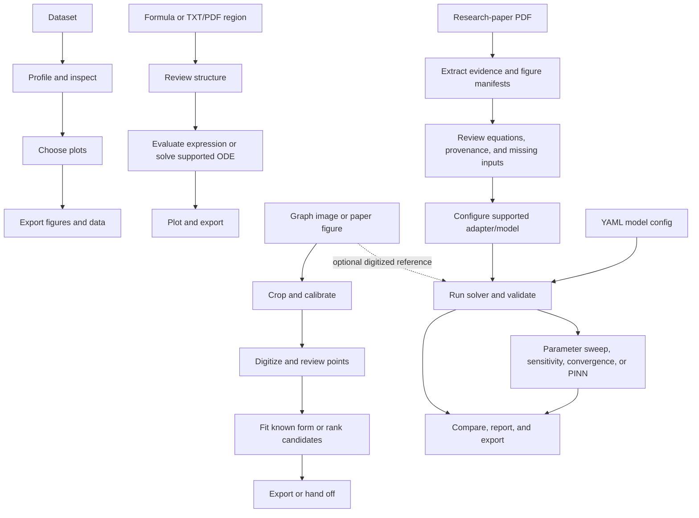

# ResearchPlotter

ResearchPlotter is a Python scientific workbench for inspecting datasets and research papers, exploring mathematical expressions, running configured numerical models, digitizing published graphs, and organizing reproducible experiments. It brings these workflows together in a Streamlit interface while keeping the underlying ingestion, model, solver, analysis, plotting, and export code in separate package modules.

The aim is to help researchers and students move from source material or data to reviewable numerical results and figures. ResearchPlotter is an evolving research application; it is not a complete replacement for MATLAB or for domain-specific scientific software. In particular, an attractive plot or a low curve-fit error is not by itself evidence of scientific validity or successful reproduction of a paper.

Paper equations and graph curves are evidence to inspect, not instructions to trust blindly. PDF extraction can lose mathematical layout, and a formula fitted to pixels generally cannot identify the original model uniquely. ResearchPlotter preserves uncertainty, provenance, and missing information so that exploratory computation is not confused with validated reproduction.

## Table of contents

- [Project overview](#project-overview)
- [Capabilities at a glance](#capabilities-at-a-glance)
- [Technology and prerequisites](#technology-and-prerequisites)
- [Installation](#installation)
- [Run the workbench](#run-the-workbench)
- [User guide](#user-guide)
- [End-to-end workflows](#end-to-end-workflows)
- [Architecture](#architecture)
- [Configuration and supported inputs](#configuration-and-supported-inputs)
- [Data, experiment history, and outputs](#data-experiment-history-and-outputs)
- [Testing and development](#testing-and-development)
- [Security and data handling](#security-and-data-handling)
- [Known limitations](#known-limitations)
- [Troubleshooting](#troubleshooting)
- [Contributing](#contributing)
- [License and acknowledgements](#license-and-acknowledgements)

## Project overview

ResearchPlotter connects several kinds of scientific work without requiring every input to be a paper-specific model:

- Profile and visualize tabular data.
- Enter a mathematical formula or review equations extracted from TXT/PDF input.
- Define a coupled model with state variables, parameters, initial conditions, and a time grid.
- Run supported ordinary or fractional reference solvers, then compare parameter choices or grid refinements.
- Recover approximate points from a graph image, fit a known equation form, or compare a small set of candidate families.
- Analyze a paper's text, layout, equation candidates, figures, and unresolved reproduction details.
- Save experiment configurations, data, figures, reports, warnings, and provenance for later review.

The shared workbench includes light and dark themes, local workspace search, Dashboard shortcuts, and pages for the workflows below. Scientific computation is performed by the package services; the Streamlit pages collect settings and present their results.

## Capabilities at a glance

The sidebar currently registers these 15 pages:

| Page | Purpose | Main workflow | Typical outputs |
|---|---|---|---|
| Dashboard | Summarize local workbench artifacts and open common tasks. | Search, inspect recent runs, or open a workflow. | Live local counts, recent experiment list, navigation. |
| Dataset Analyzer | Profile tabular data and choose useful plots. | Load data → inspect profile → select plots → export. | Profile JSON, CSV data, PNG/SVG/PDF figures. |
| Paper Analyzer | Extract reviewable evidence from a research-paper PDF. | Select/upload PDF → inspect layout and equation candidates → review limitations. | Paper-analysis JSON and editable source-linked candidates. |
| Figure Reproduction | Review a figure manifest and assess/run supported paper adapters. | Select paper and figure → inspect requirements → supply missing values → run if allowed. | Reproduction report, simulation data, figures, warnings. |
| Equation / Formula Plotter | Plot safe expressions or solve supported formula ODE systems. | Enter/upload text → review structure → set domain/parameters → plot or solve. | CSV, figure files, configuration JSON, experiment record. |
| Graph Image Analyzer | Digitize plotted curves and fit empirical equation candidates. | Upload image/PDF → crop and calibrate → extract/edit points → fit or discover candidates. | Digitized CSV, metadata, fit report, overlays and residual plots. |
| Model Simulation | Run a model described by a YAML configuration. | Choose config → edit time/parameters/initial values → choose solver → run. | Simulation CSV, configuration, validation summary, figures. |
| Parameter Sweep | Compare trajectories as one parameter changes. | Choose config and parameter → enter values → run and compare. | Sweep summary CSV, comparison figures, configuration. |
| Sensitivity Analysis | Estimate the response to a central relative parameter perturbation. | Choose config, parameter, output, and perturbation → run. | Sensitivity data CSV, curve, warnings, configuration. |
| Noise / Uncertainty | Add seeded Gaussian noise to a copied numeric data column. | Choose dataset/column and noise levels → run → compare metrics. | Separate noisy observations, metrics JSON, comparison figures. |
| Convergence / Validation | Compare solver results over time-grid refinements. | Choose config/solver and refinement factors → run and inspect errors. | Trajectories, metrics, convergence figure, JSON report. |
| PINN Experiments | Train a baseline, integer-order, or GL-fractional network on a configured trajectory. | Choose config and training settings → train → inspect losses and predictions. | Checkpoint, history, predictions, metrics, figures. |
| Figure Gallery | Browse PNG figures saved under the output tree. | Select a figure → inspect its sidecar metadata → download available formats/data. | Figure preview, metadata, available downloads. |
| Experiment History | Review local workbench run records and artifacts. | Select a record → inspect status/configuration → download or load config. | Experiment JSON details and linked artifacts. |
| Reports / Export | Inspect saved JSON reports. | Choose a report → review JSON → download. | JSON report download. |

Dashboard counts are computed from local records and files; they are not fixed product metrics. A successful run status describes software execution, not scientific reproduction status.

## Technology and prerequisites

The project uses Python 3.10 or newer as declared in `pyproject.toml`. Runtime dependencies include:

- Streamlit for the Research Workbench UI.
- NumPy, SciPy, Pandas, and Matplotlib for data and numerical work.
- SymPy for reviewed symbolic representations.
- PyMuPDF and `pypdf` for PDF extraction/reading.
- Pillow for graph-image handling.
- PyYAML and Pydantic for configuration loading and validation.
- PyTorch for PINN experiments.
- `openpyxl`, `xlrd`, and `pyarrow` for Excel and Parquet data support.
- Typer and Rich for the command-line interface; tqdm for progress reporting.

The `dev` extra adds pytest. `SALib` is declared separately as the `global-sensitivity` optional extra; the standard Sensitivity Analysis page uses the project's perturbation-based calculation and does not require SALib.

## Installation

Run commands from the repository root, the directory containing `pyproject.toml`. In PowerShell, first confirm that the selected Python is supported:

```powershell
python --version
```

Create and activate a virtual environment for a new checkout, then install the editable project and its test dependency:

```powershell
python -m venv .venv
.\.venv\Scripts\Activate.ps1
python -m pip install --upgrade pip
python -m pip install -e ".[dev]"
```

If `.venv` already exists and is the interpreter you intend to use, activate it rather than recreating it. If PowerShell does not allow activation, invoke the environment's interpreter directly instead of changing a system-wide execution policy:

```powershell
.\.venv\Scripts\python.exe -m pip install -e ".[dev]"
```

The repository also provides `requirements.txt`, which installs the declared runtime requirements, pytest, and the editable package:

```powershell
python -m pip install -r requirements.txt
```

In PyCharm, open the repository folder, select `.venv\Scripts\python.exe` as the project interpreter, install dependencies in that interpreter, and run commands from the integrated terminal at the repository root. The app, tests, and CLI must use the same environment. PyTorch can require a substantial download; the dependency is declared by the project, and the Dashboard reports which integrations are importable in the active environment.

## Run the workbench

Start Streamlit from the repository root:

```powershell
python -m streamlit run src/research_plotter/app.py
```

Open the local URL printed in the terminal, usually `http://localhost:8501`. Streamlit may choose another port if that port is already in use. Stop the process with **Ctrl+C** in the terminal.

To inspect the CLI:

```powershell
python -m research_plotter --help
```

The installed console command is also available:

```powershell
research-plotter --help
```

Common CLI commands are:

```powershell
python -m research_plotter analyze-data data/examples/measurements.csv
python -m research_plotter plot data/examples/measurements.csv
python -m research_plotter analyze-paper Papers/333.pdf
python -m research_plotter sweep configs/examples/basic_ode.yaml
python -m research_plotter sensitivity configs/examples/basic_ode.yaml r --output population
python -m research_plotter convergence configs/examples/fractional_alzheimer.yaml
python -m research_plotter reproduce Papers/fninf-20-1748481.pdf --config configs/paper_2.yaml
```

The generic `reproduce` command also accepts optional Paper 1 initial conditions, end time, and time step. Those values are user inputs, not values established by the paper; a run remains exploratory/partial where source ambiguities persist. For example, after reviewing the source and choosing explicit exploratory inputs:

```powershell
python -m research_plotter reproduce Papers/333.pdf --initial-conditions '{"S":0.9,"E":0.5,"T":0.9,"C":0}' --time-end 90 --step 0.1
```

Use `python -m research_plotter <command> --help` to see each command's arguments. The CLI is implemented for paper/data analysis, plotting, reproduction, configured parameter sweeps, sensitivity, and grid refinement; graph-image analysis and interactive fitting are currently workbench/API workflows.

## User guide

### 1. Dashboard

The Dashboard reads local workbench records and saved output files. Summary cards link to experiment history, the figure gallery, paper analysis, and reports. The dependency panel checks whether libraries can be found in the active Python environment; an available indicator does not mean every experiment has been validated. Recent runs show their execution status separately from any scientific/reproducibility status.

Use the sidebar to navigate, the top search to find indexed local datasets, PDFs, experiments, figures, or reports, and Quick Start buttons to open formula plotting, data analysis, figure reproduction, or model simulation. The theme toggle switches between the shared light and dark palettes. Counts and search results depend on files currently present under the workspace and `outputs/`.

### 2. Dataset Analyzer

The analyzer accepts CSV, delimited TXT tables, XLSX, XLS, JSON, and Parquet. Plain prose in a `.txt` file is not treated as a table. You can select a bundled example, upload a file, or open a dataset selected from local search.

1. Select a source and click **Analyze dataset**.
2. Review row/column counts, duplicates, missingness, column types, possible time-like columns, descriptive statistics, and profiler recommendations.
3. Inspect the preview and choose from suggestions supported by the data: line plots when a time-like column and numeric data exist; scatter plots and correlation heatmaps for multiple numeric columns; histograms/box plots for numeric columns; grouped box plots when categorical and numeric columns are present.
4. Choose axes/columns and generate only the figures you want.
5. Download the table as CSV and download generated figures in the formats made for that run.

The profiler flags time-like columns by type/name heuristics; it does not prove the data are a valid time series. Numeric profiling includes ranges, summary statistics, correlations, constant/low-cardinality flags, and IQR-based outlier counts. Missing values are reported; the page does not claim to perform a general inferential analysis or automatically repair the data.

### 3. Paper Analyzer

Paper Analyzer is the primary page for full research-paper PDFs. Select a local PDF or upload one, then click **Analyze paper**. The parser presents title/authors/sections when found, layout-region counts, candidate equations, parameter/state-variable/method information, figure captions/manifests, and unresolved evidence. Select an equation candidate to view the rendered source region beside its editable representation and confidence/review status. Save a review after comparing the representation to the source. A saved acceptance records a human review decision; it does not independently prove transcription correctness or make unsupported mathematics executable.

Use the expandable sections to inspect extraction statuses, provenance, and limitations. Download the analysis JSON for another review or record. **Assess reproduction** checks the existing adapter path and writes a report; it is not equivalent to reproducing every detected figure. PDF extraction is layout-aware but not mathematical OCR, so verify Greek symbols, indices, superscripts, fractions, and equation numbering against the rendered page.

### 4. Figure Reproduction

This page connects an analyzed paper's figure manifests to available paper-specific adapters. Select a local paper or upload a PDF, then choose a detected figure. Review its caption, source page preview, plot variables, parameter/sweep values, time range, solver, linked equation candidates, missing inputs, and provenance before running anything.

For Paper 1, the page requires user-supplied initial conditions and time-grid details that the source does not establish; Figures 11 and 12 also require explicit user-provided sweep values. Review linked equations before the adapter run. Such a run can produce exploratory trajectories but remains scientifically unresolved because recurrence indexing and other details are ambiguous.

For Paper 2, the current page can run a configured partial baseline, not a selected published-figure reproduction. User-supplied YAML may provide missing settings, but controlled equations, NSFD details, and training information are not silently inferred. A visual reference image can be shown alongside output, but the page does not calculate trajectory metrics from the image alone. Use the Graph Image Analyzer to digitize the reference if a numerical comparison is needed.

### 5. Equation / Formula Plotter

The Formula Plotter has three input modes: manual formula, TXT, and PDF. It supports safe explicit functions, parameterized functions, parametric curves, and ordinary ODE systems where the input matches its parser. TXT/PDF text is editable; uploaded/extracted text must be reviewed before a supported expression or model is run. PDF mode selects equation-like regions and shows the source crop rather than sending an entire research-paper page to the explicit-formula parser.

1. Choose **Manual formula**, **Upload TXT**, or **Upload PDF**.
2. Enter or review the mathematical text. A supported explicit formula can be written as:

   ```text
   y = exp(-0.1*x) * cos(5*x)
   ```

3. Set the independent variable, domain, and number of samples. For the example above, use `x` from `0` to `20`.
4. Supply numeric values for any free parameters. For an ODE system, supply initial conditions such as `x=10, y=5` and select an available solver.
5. Click **Analyze Equation**, inspect the detected structure and parameters, then click **Plot / Run Equation**.
6. Review the preview and download data, figure formats, and configuration JSON when provided.

The supported expression grammar is intentionally limited to arithmetic, powers, symbols, `sin`, `cos`, `tan`, `exp`, `log`, `sqrt`, `abs`, and constants `pi`/`E`. ODE equations use the form `dx/dt = ...` (one right-hand side per state); initial values are supplied separately. Parametric input uses paired expressions such as `x(t)=cos(t)` and `y(t)=sin(t)`. The Formula Plotter does not execute arbitrary Python. Fractional equations, recurrences, algebraic systems, or poorly extracted PDF text remain review structures unless a supported model pathway is available; they are not silently converted to `y=f(x)`.

The ODE mode offers `ode`, `explicit_euler`, and `grunwald_letnikov`. Selecting a fractional solver changes the derivative interpretation and is not automatically scientifically appropriate for any supplied RHS. Confirm the equation/operator pairing before interpreting a result.

### 6. Graph Image Analyzer

Graph Image Analyzer estimates data represented by pixels and optionally fits empirical equation candidates. It does not restore the original experimental data. The initial workflow supports PNG, JPG/JPEG, WEBP, TIFF/TIF, and a rendered page from a PDF. Image inputs are size-checked; processing is intended for manageable raster images rather than arbitrarily large files.

1. **Choose the source.** Upload an image/PDF, or open a published figure handed off from Figure Reproduction. For a PDF, select the page to render.
2. **Crop one plot.** Open the advanced crop controls and set the crop bounds around the actual plotting area. Keep axes/curve content, but avoid titles, legend swatches, and inset plots when possible. Digitize an inset as a separate crop with its own calibration.
3. **Calibrate both axes.** Enter left/right pixel anchors and corresponding X values, plus top/bottom pixel anchors and corresponding Y values. Pixel coordinates are measured in the original rendered image; image Y coordinates increase downward. Choose linear or logarithmic scales. Log calibration requires positive data anchors. Tick-label detection is not authoritative; use visible ticks and inspect the configured mapping.
4. **Exclude contaminating regions.** Add optional rectangles in original-image pixel coordinates to mask a legend, inset, or annotation. If a rectangle crosses a curve, it creates a gap; the application does not interpolate across that gap. Incorrect exclusions can also remove true curve points.
5. **Select and extract curves.** Inspect detected RGB colors, select and name the curves, optionally add a color manually, set the color-distance tolerance, and cap the number of points. The extractor segments selected colors and keeps a median vertical pixel position per image column. Tight crops and distinct colors improve separation; overlapping lines, similar colors, anti-aliasing, markers, gridlines, labels, and legend samples may contaminate results.
6. **Inspect digitized points.** Review warnings, point counts, ranges, table, and overlays on the crop. Edit or remove points in the data editor if needed, and save corrections separately; edits have `USER_PROVIDED` provenance. The default CSV representation is long form with curve name, source pixel coordinates, and calibrated `x`/`y` values; a wide-form conversion is also available in the analysis backend.
7. **Choose a fitting mode.** In **Fit / Compare**, either enter a known equation template with optional initial guesses/bounds, or discover supported candidate families. Fitting uses the safe formula parser and bounded SciPy least squares. Candidate discovery requires enough points and holds out every fifth x-sorted point for ranking.
8. **Review results.** Inspect the readable equation, estimated parameters, local covariance uncertainty when available, RMSE, MAE, R² when defined, residuals, warnings, and digitized-data overlay. A candidate is an empirical approximation, not proof of the paper's source equation. Local covariance errors do not include image calibration, pixel extraction, or model-selection uncertainty.
9. **Export or continue.** Download digitized data, metadata/configuration, fit results, residual and overlay figures. Send extracted points to Dataset Analyzer or send a selected fitted expression and estimates to Formula Plotter. A paper-derived digitized curve can be compared with available simulation data over a common X range using interpolation; the report is an `UNVERIFIED` digitized-reference comparison, not ground-truth validation.

Candidate discovery is intentionally limited to implemented families: linear, polynomial degrees 2–4, exponential, sinusoidal, damped sinusoidal, logistic, and (only on valid positive domains) logarithmic and power-law candidates. It ranks candidates by held-out RMSE, then BIC and parameter count as tie-breakers. Similar candidates may remain visible. A good fit does not establish the equation originally used by a researcher.

For further extraction/calibration detail, see [`docs/graph_image_analysis.md`](docs/graph_image_analysis.md).

### 7. Model Simulation

Model Simulation loads a bundled example YAML or a compatible uploaded YAML file. A model config describes a model name, states, right-hand-side expressions, solver, time interval, parameter values, initial conditions, and optional sweep/plot metadata. The UI creates controls from those state/parameter entries.

1. Select or upload a YAML configuration.
2. Review the model name and states; edit start/end time, step, parameters, and initial conditions.
3. Choose `ode`, `explicit_euler`, or `grunwald_letnikov` where applicable. The latter requires a uniform time grid and fractional order; do not use a classical ODE solver as a fractional substitute.
4. Choose the states to display and run the simulation.
5. Inspect the trajectory, runtime, solver diagnostics, warnings, and validation summary. Download CSV data, figure files, or the saved configuration.

The included [`configs/examples/basic_ode.yaml`](configs/examples/basic_ode.yaml) is a small logistic-growth example. The [`fractional_alzheimer.yaml`](configs/examples/fractional_alzheimer.yaml) example is useful for exploring a configured fractional model; it is not evidence of exact reproduction of the Alzheimer paper.

### 8. Parameter Sweep

The UI sweep runs the configured solver repeatedly while varying one selected model parameter over the values entered by the user. Choose a YAML model, parameter, output state, solver/time settings, and comma-separated parameter values, then run the sweep. The page displays an output-trajectory comparison, a table of final output values and runtimes, and CSV/figure downloads. A sweep can become expensive as the number of values and simulation grid points grow. The CLI sweep reads its parameter values from the model's `sweep` mapping.

### 9. Sensitivity Analysis

The current method is a central relative perturbation: solve at `p(1+δ)` and `p(1−δ)` and calculate a logarithmic response from the absolute output values. The UI defaults to a 10% perturbation and lets you choose one parameter and one state or all states. Select a model config, set interval/solver settings and perturbation percentage, run, then inspect the sensitivity curve, data table, warnings, and CSV/figure exports.

Interpret results with care when an output crosses or approaches zero: the backend uses logarithms of absolute state values and warns that zero or negative values create undefined or sign-insensitive behavior. This page is not a global variance-based sensitivity study; SALib is an optional project extra, not the method used here.

### 10. Noise / Uncertainty

This page runs seeded Gaussian perturbation experiments on one numeric column from an example or uploaded dataset. Enter one or more noise levels as percentages (the default is 0, 5, 10, 15, and 20), select the X axis and observation column, and choose a random seed. Noise scale is the selected clean column's standard deviation multiplied by the level. The clean data remains separate and unchanged. Review the synthetic series, MSE/MAE/RMSE metrics, and comparison plot, then download the noisy observations and metrics.

This is a configurable synthetic perturbation workflow, not a complete statistical uncertainty analysis and not evidence of measurement noise in the original experiment.

### 11. Convergence / Validation

The Convergence / Validation page compares a model's simulation on user-selected refinement factors, typically `1, 2, 4` where factor `n` means step size `dt/n`. Choose the model and available solver, base interval/step, fractional order when relevant, and factors. The interval must be divisible by each resulting step. The finest requested grid is used as a numerical reference, and coarser trajectories are compared to it after interpolation.

Review trajectory data, RMSE/error metrics, refinement plot, observed order estimates, and warnings. An observed order is descriptive for these grids only; it is not automatically a theoretically established convergence order or proof against an exact solution.

### 12. PINN Experiments

PINN Experiments offers three modes: a data-driven **baseline** network, an **integer-order PINN** with an ordinary derivative residual, and a **fractional** PINN using a numerical Grünwald–Letnikov history residual. It uses the configured model's solver trajectory as reference data. The page exposes network depth/width, activation, optimizer, learning rate, epochs, points, physics weight, state, fractional order, observation noise, and random seed. Small defaults make a quick experiment possible; longer training can take appreciably more time.

After training, inspect loss history, reference/observed/predicted trajectories, metrics against the clean configured trajectory, training time, warnings, and validation status. Predictions, training history, a PyTorch checkpoint, configuration, and figures are saved/downloadable. The GL residual uses a nonlocal numerical history calculation; ordinary automatic differentiation is used for ordinary-order derivatives only. Training completion or low loss does not prove the model or paper reproduction is correct. See [`docs/solver_notes.md`](docs/solver_notes.md) and [`examples/pinn_smoke.py`](examples/pinn_smoke.py).

### 13. Figure Gallery

The gallery searches local `outputs/` recursively for PNG figures and shows up to the most recent 300. Select a path to preview it and inspect the adjacent JSON sidecar when one exists. Download other formats if they were saved alongside the PNG; associated CSV data is offered when the application can locate it. The gallery is an artifact browser, not a source of paper figures unless they were saved into the output tree.

### 14. Experiment History

Workbench runs write an `experiment.json` record containing a generated experiment ID, workflow, timestamp, runtime, execution status, details, and artifact paths. Select a record to inspect it and download relevant JSON/CSV artifacts. When a configuration YAML is present, download it or load it into Model Simulation as the starting point for another run. History is local filesystem metadata; it does not create a database or promise cloud backup. The record may reference artifacts rather than embedding their full contents.

### 15. Reports / Export

Reports / Export indexes JSON files under `outputs/reports/` and `outputs/paper_reproduction/`. Select a report to view its structured contents and download the JSON. Other exports (such as CSV data and PNG/SVG/PDF figures) are available from their workflow page, Figure Gallery, or experiment artifacts when those formats were generated. A report describes the run and its evidence/status; it does not upgrade an exploratory or blocked result to a validated reproduction.

## End-to-end workflows

The arrows below describe common paths. Some transitions are user-driven: for example, choose the paper figure, review extracted text, provide missing values, select plot columns, or hand off a digitized dataset.



### Explore a formula

Formula text → safe parsing and structure review → parameter/domain configuration → direct plotting or supported ODE solver → data/figure/configuration export → experiment record.

### Analyze a dataset

Dataset → profile → review column types and time candidates → choose suggested plot(s) → inspect and download outputs. The analyzer recommends plots; it does not force all possible plot types onto every dataset.

### Reconstruct a graph

Graph/PDF page → crop → calibrate axes from user-supplied anchors → select curve colors and exclusions → digitize points → inspect/edit → fit a known form or rank candidates → export/handoff. The generated data are pixel-based estimates.

### Analyze and investigate a paper

PDF → layout-aware evidence extraction → review the original equation/figure regions → inspect figure manifests and missing information → configure only a supported model/adapter → run and validate → compare with a digitized reference if available. Paper-specific reproduction status remains distinct from run success.

### Simulate and compare parameters

YAML model → review solver/time/parameter/initial values → simulation → sweep, sensitivity, or grid refinement → inspect metrics and warnings → save artifacts and configuration.

## Architecture

ResearchPlotter keeps scientific services outside the Streamlit layer. The UI gathers input, calls these APIs, and renders their output. Generic plotters and solvers do not select behavior by paper name; paper-specific facts and adaptations are isolated under `paper_adapters/` and paper-analysis/reproduction modules.

```text
ResearchPlotter/
├── src/research_plotter/
│   ├── app.py, cli.py, config.py      # Application, CLI, validated YAML
│   ├── ui/                            # Shared shell and Streamlit page views
│   ├── ingestion/                     # PDF and dataset input/profiling
│   ├── paper_analysis/                # Layout, equation, method, figure parsing
│   ├── paper_adapters/                # Source-specific paper facts/models
│   ├── models/                        # FormulaSpec, ModelSpec, variables
│   ├── solvers/                       # ODE and history-dependent solvers
│   ├── analysis/                      # Sweeps, sensitivity, validation, fitting
│   ├── plotting/                      # Reusable Matplotlib figures and export
│   ├── pinn/                          # Networks, losses, residuals, trainer
│   ├── pipelines/                     # Dataset, paper, graph, PINN workflows
│   └── utils/                         # Paths, logging, numerics, reproducibility
├── configs/                           # Paper configs and runnable examples
├── data/examples/                     # Small example dataset(s)
├── docs/                              # Workflow, architecture, and solver notes
├── examples/                          # Scripted examples and PINN smoke run
├── outputs/                           # Local generated artifacts
└── tests/                             # Pytest coverage of services and UI
```

`FormulaSpec` represents safe explicit, parametric, and ODE inputs. `ModelSpec` describes coupled states, parameters, equations, initial conditions, derivative metadata, and solver requirements. Solvers return structured simulation results; analysis routines consume those results or data frames; Matplotlib plotters do not parse papers. PDF equation candidates are editable and reviewable, not executable merely because they were extracted.

Additional implementation notes are available in [`docs/architecture.md`](docs/architecture.md), [`docs/dataset_workflow.md`](docs/dataset_workflow.md), [`docs/paper_workflow.md`](docs/paper_workflow.md), [`docs/solver_notes.md`](docs/solver_notes.md), and [`docs/scientific_validation.md`](docs/scientific_validation.md).

## Configuration and supported inputs

### Model YAML

The application loads YAML configuration as data, validates common fields with Pydantic, and checks model expression symbols before building the model. A minimal form resembles the included [`basic_ode.yaml`](configs/examples/basic_ode.yaml):

```yaml
model:
  name: logistic
  states: [population]
  equations:
    population: r*population*(1-population/K)
  sweep:
    r: [0.4, 0.6, 0.8]
solver:
  type: ode
time:
  start: 0
  end: 10
  step: 0.1
parameters:
  r: 0.6
  K: 1.0
initial_conditions:
  population: 0.1
```

The expression layer permits arithmetic and a small set of mathematical functions (`sin`, `cos`, `tan`, `exp`, `log`, `sqrt`, `abs`) over declared state, parameter, and independent-variable symbols. Use a compatible existing example as a starting point. Model solver choices in the GUI/CLI are narrower than every solver class exposed in Python.

Paper-specific override configuration is separate from general model YAML. [`configs/paper_1.yaml`](configs/paper_1.yaml) records Paper 1 evidence and unresolved reproduction requirements. [`configs/paper_2.yaml`](configs/paper_2.yaml) records Paper 2 baseline parameters/provenance and unresolved controls, NSFD, and PINN settings. Do not relabel unknown or user-supplied values as source-paper facts.

### Input formats

| Input | Supported formats in the current UI/services |
|---|---|
| Dataset Analyzer and Noise / Uncertainty | CSV, delimited TXT tables, XLSX, XLS, JSON, Parquet |
| Paper Analyzer and Figure Reproduction | PDF |
| Equation / Formula Plotter | Manual text, UTF-8 TXT, PDF with selectable reviewable equation regions |
| Graph Image Analyzer | PNG, JPG/JPEG, WEBP, TIFF/TIF, or a rendered page from PDF |
| Model configuration | YAML (`.yaml` or `.yml`) |

Text/PDF mathematical extraction is layout-sensitive. Dataset readers and graph image processing require the matching declared dependencies in the environment. Very large or malformed files can fail validation; no universal upload-size guarantee is claimed.

## Data, experiment history, and outputs

The application writes generated artifacts beneath `outputs/` relative to the repository root. Common locations include:

- `outputs/reports/workbench/<workflow>/<experiment-id>/` for UI run metadata and artifacts.
- `outputs/reports/` for dataset profiles, CLI reports, and analysis results.
- `outputs/figures/` for CLI-generated figures and other directly saved plots.
- `outputs/paper_reproduction/<paper-key>/` for paper analysis/reproduction reports, manifests, configurations, warnings, and simulation data.
- `outputs/uploaded/` for files persisted by selected upload workflows.

The exact subfolders vary by workflow. Experiment records are JSON files; simulation/digitization/noise tables are generally CSV; configurations may be YAML or JSON; figure sidecars are JSON. Matplotlib exports commonly include PNG and SVG, with PDF available in workflows that request it. Only formats actually generated for an artifact appear as download choices.

Local raw and processed data, PDFs, uploads, and generated run output are ignored by default in `.gitignore`; only specific documented Paper 1/Paper 2 analysis, configuration, and diagnostic records are allowlisted under `outputs/paper_reproduction/`. Verify source-document and dataset redistribution rights before adding material to a public repository; see [`Papers/README.md`](Papers/README.md) for the repository's local paper notes. Review generated files and local data before committing. Do not delete existing scientific outputs as part of environment setup.

The Experiment History page scans local `experiment.json` records and can load a saved configuration into Model Simulation. It is filesystem-backed rather than database-backed; move or remove artifacts only if you intend to change what local history can access.

## Testing and development

From the repository root, with the project environment active:

```powershell
pytest -q
python -m compileall src
python -c "import research_plotter; print(research_plotter.__file__)"
```

- `pytest -q` runs the configured test suite.
- `python -m compileall src` checks Python source syntax.
- The import command verifies that the installed/editable `src` package resolves in the selected interpreter.

For a small deterministic PINN and solver comparison smoke workflow:

```powershell
python examples/pinn_smoke.py
```

This writes reviewable smoke artifacts under `outputs/reports/pinn_smoke/`; it is not a full research-paper experiment or reproduction claim. For GUI changes, launch the app with the documented Streamlit command and exercise the affected page. For numerical changes, add a small reference/synthetic test with an explicit tolerance. Do not assert a theoretical convergence order without analytical or independent numerical support.

See [`CONTRIBUTING.md`](CONTRIBUTING.md) for the existing local development guidance.

## Security and data handling

Treat uploaded datasets, documents, images, and equations as untrusted input. Formula input is parsed by a restricted AST allowlist and converted to SymPy; it is not passed to Python `eval()` or `exec()`. Model expressions are limited to validated symbols and supported arithmetic/functions. YAML configuration uses safe loading and must have a mapping at its root. These controls are not a guarantee that every file is benign: do not upload secrets or private data to an environment you do not control, and do not treat a paper-derived expression as executable without review and validation.

Some workflows persist uploads or derived artifacts under `outputs/uploaded/` and experiment directories for local continuity. Generated metadata may contain source paths, paper names, parameter values, and run details. Review it before sharing. See [`SECURITY.md`](SECURITY.md) for the repository's current security-reporting notes; no separate disclosure service is configured there.

## Known limitations

- **PDF mathematics is not OCR.** Layout blocks and equation-like regions are detected conservatively, and source crops are shown for human review. Greek symbols, stacked fractions, subscripts, superscripts, and indices may be lost or reordered.
- **Paper extraction is evidence, not ground truth.** Captions, parameter values, and equation links may be partial or uncertain. Human acceptance records review, not independent verification.
- **Paper 1 exact reproduction is blocked.** The available source information does not establish all simulation initial conditions or step size, and the displayed recurrence has an indexing ambiguity. The Figure 11/12 sweep values are not tabulated. User-entered values can support exploratory runs but do not resolve those source gaps.
- **Paper 2 reproduction is partial.** The controlled equations, NSFD update details, and sufficient PINN training settings are missing or incomplete; some figure descriptions/scales also require review. NSFD settings may be recorded, but this project does not claim an NSFD run. Configured baseline/GL/PINN work remains partial or exploratory where relevant.
- **Graph digitization is approximate.** Pixel resolution, anti-aliasing, plot crop, axis calibration, overlapping curves, color similarity, labels, legends, insets, and exclusions affect extracted data. The user must confirm axes and inspect the overlay.
- **Equation fitting is not equation recovery.** The candidate family set is finite and graph data may support several similar formulas. Parameter uncertainties are local covariance estimates conditional on the selected family and digitized points; they omit digitization, calibration, and model-selection uncertainty.
- **History depends on local files.** Experiment records reference paths and do not provide database, cloud, or backup guarantees.
- **Reference numerical methods have limits.** Fractional history methods can have quadratic cost in the number of grid steps, require uniform grids in relevant implementations, and are not automatically interchangeable with every published operator variant. Refine and validate results for the intended model.
- **PINN training is exploratory.** Loss reduction or a completed optimizer loop alone does not establish a scientifically correct solution.
- **Status vocabulary matters.** `SUCCEEDED` describes run completion; statuses such as `PARTIAL`, `UNVERIFIED`, `NEEDS_REVIEW`, and `BLOCKED` describe unresolved scientific or workflow evidence. See [`docs/scientific_validation.md`](docs/scientific_validation.md).

## Troubleshooting

| Symptom | Checks and actions |
|---|---|
| Python/package version error | Run `python --version`; use Python 3.10 or newer, then verify that PyCharm, Streamlit, CLI, and pytest use the same interpreter. |
| `No module named research_plotter` | From the repository root, activate `.venv` and run `python -m pip install -e ".[dev]"`; check `python -c "import research_plotter; print(research_plotter.__file__)"`. |
| Missing Streamlit or another dependency | Install the project requirements in the active environment with `python -m pip install -e .` or `python -m pip install -r requirements.txt`, then restart Streamlit. |
| Streamlit command starts from the wrong directory | Change to the repository root (the directory with `pyproject.toml`) and run `python -m streamlit run src/research_plotter/app.py`. |
| Port 8501 is occupied | Stop the other Streamlit process or specify another port, for example `python -m streamlit run src/research_plotter/app.py --server.port 8502`. |
| TXT table is rejected | Ensure it contains a consistent delimiter/columns and numeric cells where applicable. Ordinary mathematical text belongs in Equation / Formula Plotter, not the dataset reader. |
| Formula is rejected | Check the supported syntax/functions, use `**` or `^` for powers, remove unsupported Python constructs, and declare only symbols that represent the independent variable or fitted/model parameters. |
| Formula requests parameter or initial values | Supply finite numeric parameter values for each free symbol; ODE systems also require an initial value for every state. Do not fill missing scientific values by guess without labeling them as assumptions/user inputs. |
| PDF equations look mangled or no regions are detected | Try another page, inspect the rendered page/region, and edit the extracted candidate. Scanned/image-only PDFs or complex typography may not provide usable text extraction; Paper Analyzer is the full-paper workflow. |
| Digitized curve is empty or jumps unexpectedly | Crop to the actual axes, correct the pixel/data anchors, confirm selected RGB colors and tolerance, exclude a legend/inset, and inspect gaps/overlays before fitting. Analyze inset plots separately. |
| Equation fit fails or parameters are unstable | Confirm that the selected curve is appropriate, enough distinct X values remain, the template is safe and has free parameters, initial guesses are sensible, and bounds contain those guesses. A failed fit may indicate non-identifiability or insufficient data. |
| Simulation configuration fails | Check YAML indentation, root mapping, one equation per state, declared parameter/state names, finite initial values, `end > start`, and positive step. Fractional GL runs require a uniform grid. |
| Paper run reports `PARTIAL` or `BLOCKED` | Read the unresolved-information list and provenance. The status may correctly reflect missing source details; supplying an explicit user value can enable an exploratory run without proving it came from the paper. |
| Expected output is missing | Inspect the run record and its artifact paths under `outputs/`; failed runs may have an `experiment.json` but no result figure/data. Verify permissions and avoid changing the source PDFs/configs while troubleshooting. |
| Tests/compile/import use the wrong Python | Check `Get-Command python`, `python --version`, activate `.venv`, then repeat the project checks from the repository root. |

## Contributing

Keep changes focused and preserve the boundary between generic backends and paper-specific adapters. Record provenance for source, user-provided, assumed, or unknown values; retain scientific warnings; and add deterministic tests for meaningful numerical or parsing changes. Do not describe an exploratory result as exact reproduction merely because code produced a figure.

Before opening a change, run the checks in [Testing and development](#testing-and-development). See [`CONTRIBUTING.md`](CONTRIBUTING.md) for additional project conventions.

## License and acknowledgements

The original ResearchPlotter code is licensed under the [MIT License](LICENSE), subject to the ownership and attribution checks reflected in the repository. This license does not imply that the project owner owns third-party code or has the right to license any bundled or user-provided research paper, publisher figure, dataset, logo, or other external material. Those materials retain their own copyright and redistribution terms; users are responsible for obtaining and following the permissions that apply to material they use. Third-party dependencies retain their respective licenses and notices. The MIT license does not override those terms.

ResearchPlotter is built with and gratefully uses open-source libraries declared in [`pyproject.toml`](pyproject.toml), including [NumPy](https://numpy.org/), [SciPy](https://scipy.org/), [Pandas](https://pandas.pydata.org/), [Matplotlib](https://matplotlib.org/), [SymPy](https://www.sympy.org/), [PyTorch](https://pytorch.org/), [Streamlit](https://streamlit.io/), [PyMuPDF](https://pymupdf.readthedocs.io/), [pypdf](https://pypdf.readthedocs.io/), [Pillow](https://python-pillow.org/), [PyYAML](https://pyyaml.org/), [Pydantic](https://docs.pydantic.dev/), [Typer](https://typer.tiangolo.com/), [Rich](https://rich.readthedocs.io/), and [tqdm](https://tqdm.github.io/). Their authors and maintainers do not thereby endorse ResearchPlotter.

The local paper directory includes [`Papers/README.md`](Papers/README.md) with notes about the bundled research-paper validation cases and their reproducibility limitations.
